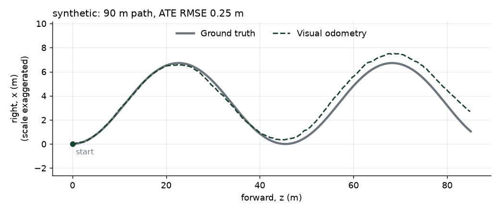

# vision-nav-lab

Monocular visual odometry for GNSS-denied navigation: track features in a camera's video, recover how the camera moved, and score the path against ground truth. Built in Python and OpenCV, with a C++17 coordinate-frames library and a ROS2 node.

**Results page:** https://vision-nav-lab.vercel.app

[](https://github.com/Shreyashsalv2/vision-nav-lab/actions/workflows/ci.yml)



## Results (synthetic sequence, 300 frames, 90 m)
| Metric | Value |
|---|---|
| ATE RMSE (absolute trajectory error after SE(3) alignment) | **0.25 m** |
| Final drift (end-point error / distance travelled) | **1.9%** |
| RPE per frame: translation / rotation | 0.032 m / 0.13° |
| RPE over 10 frames: translation / rotation | 0.099 m / 0.43° |
| Features tracked per frame / RANSAC inliers | 470 / 102 |
| Frames needing the constant-velocity fallback | 0% |

Full numbers: [`results/synthetic/metrics.json`](results/synthetic/metrics.json). CI regenerates the sequence and fails if ATE RMSE goes above 0.5 m or drift above 3.5%.

## How it works
1. **Camera model and calibration:** pinhole camera with radial-tangential distortion. `scripts/calibrate.py` runs checkerboard calibration (Zhang's method); on rendered board views it recovers the focal length within 0.1% and the image centre within half a pixel.
2. **Feature tracking:** Shi-Tomasi corners tracked with pyramidal Lucas-Kanade. A forward-backward check (< 1 px) drops bad tracks, and new corners are detected away from existing ones when fewer than 350 survive.
3. **Motion between frames:** pixels are undistorted to normalized coordinates, then a five-point essential matrix with RANSAC is decomposed into rotation and direction of travel (`cv2.recoverPose`). Frames with too few inliers fall back to constant velocity.
4. **Scale and chaining:** a single camera cannot see metric scale, so each step's length comes from a speed source. That's ground truth here, as in standard monocular VO evaluation; on a robot it would be an altimeter, wheel odometry or an IMU. Steps are chained into a trajectory.
5. **Coordinate frames (C++17):** `cpp/` converts poses from the camera's optical convention (x right, y down, z forward) to ROS body convention (x forward, y left, z up, REP-103). It comes with a CLI, pybind11 bindings used by the Python package, and 13 GoogleTest tests.
6. **Evaluation:** ATE after Umeyama alignment, RPE over 1 and 10 frames, and final drift.

## Data
- **Synthetic (default):** `scripts/make_synthetic.py` renders a camera flying through 9,000 landmarks with lens distortion and image noise. The ground-truth path is exact and the output is deterministic from a seed. It uses the TUM layout (`rgb.txt`, `groundtruth.txt`, `camera.json`).
- **TUM RGB-D:** `--dataset tum --path <sequence> --camera <camera.json>`. Write the sequence's published intrinsics into a camera JSON (same fields as `vnav/camera.py`). Images are matched to ground truth by timestamp.
- **KITTI odometry:** `--dataset kitti --path <root> --seq 00`. The camera comes from `calib.txt` P0 (rectified images).

## ROS2 (Humble)
```bash
cd ros2 && colcon build --packages-select vnav_ros && source install/setup.bash
export PYTHONPATH=/path/to/vision-nav-lab:$PYTHONPATH
ros2 launch vnav_ros playback.launch.py sequence_dir:=/path/to/data/synthetic
```
The node plays back a recorded sequence folder, or subscribes to `camera/image_raw` (scaled by `step_scale`). It publishes `nav_msgs/Odometry` on `vnav/odom`, `nav_msgs/Path` on `vnav/path`, and the `odom → base_link` transform.

## Run it
```bash
pip install -r requirements.txt
scripts/build_cpp.sh                                   # C++ library, CLI, tests, Python module (optional)
python scripts/make_synthetic.py --out data/synthetic
python scripts/run_vo.py --dataset synthetic --path data/synthetic --out results/synthetic
python scripts/calibrate.py --demo                     # checkerboard calibration on rendered views
```

## Tests
```bash
ctest --test-dir build/cpp --output-on-failure   # 13 GoogleTest tests
pytest -q                                        # 21 Python tests
```
- **Python tests** cover: quaternion and transform maths including the half-turn edge case; the C++ and NumPy frame conversions agreeing; camera projection and undistortion round trips; tracking a known image shift to within 0.1 px; exact relative-pose recovery; calibration recovering a known camera; dataset readers; and an accuracy test on a short sequence.
- **CI** runs on Ubuntu Linux: the C++ build and tests, the Python tests, the full sequence with the accuracy gate, and a ROS2 Humble job that builds the package, runs an in-process node test and smoke-tests `ros2 run`.

## Layout
```
vnav/        camera, features, motion, odometry, metrics, io, calibration, synthetic, frames, plots
cpp/         C++17 frames library, CLI, pybind11 bindings, GoogleTest tests
ros2/        vnav_ros package (node, launch file, test)
scripts/     make_synthetic, run_vo, calibrate, build_cpp.sh, build_site
results/     committed results for the synthetic sequence
site/        results page (Vercel)
```

## Limits
Monocular only, with scale from an external source. There is no loop closure, bundle adjustment or IMU fusion, and no tuning for embedded boards. The results above are on synthetic data; real sequences are noisier.

## License
MIT
